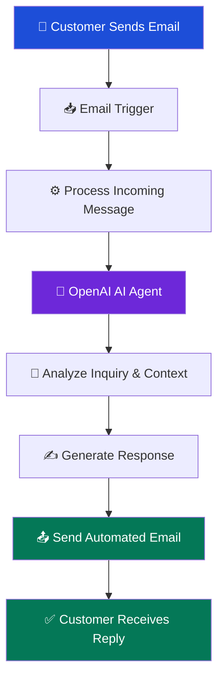

 

# 🤖 AI-Powered Email Automation Agent

### Intelligent Travel Agency Customer Support System

  
  
  
  

**Automating customer communication with intelligent AI agents.**

---

## 📌 About The Project

An intelligent email automation system developed using **n8n and OpenAI** to automate customer inquiries for a travel agency.

The system receives customer emails, understands their questions, analyzes available travel packages and pricing information, and generates context-aware responses using an AI-powered agent.

The goal is to simplify customer support, reduce repetitive manual work, and deliver faster communication.

---

## 🖼️ Workflow Architecture

 

Complete automation workflow built with n8n

---

## ✨ Key Features

<table>
<tr>
<td width="50%">

### 🤖 AI-Powered Responses
Automatically understands and responds to customer inquiries using OpenAI.

</td>
<td width="50%">

### 🧠 Context-Aware Intelligence
Uses customized system instructions and travel agency knowledge.

</td>
</tr>
<tr>
<td width="50%">

### 🧳 Travel Package Information
Provides relevant package details and pricing information.

</td>
<td width="50%">

### ⚡ Automated Email Handling
Processes incoming inquiries and handles automated email replies.

</td>
</tr>
<tr>
<td width="50%">

### 🔗 API Integration
Connects AI services with email and automation workflows.

</td>
<td width="50%">

### ⏱️ Time Efficiency
Reduces repetitive customer support tasks and response time.

</td>
</tr>
</table>

---

## 🛠️ Technology Stack

| Technology | Purpose |
|:---:|:---|
| **n8n** | Workflow automation and orchestration |
| **OpenAI** | AI-powered inquiry analysis and response generation |
| **Email Integration** | Receiving and sending customer emails |
| **API Integration** | Connecting external services |
| **System Prompt** | Defining AI behavior and business knowledge |

---

## ⚙️ How It Works

### Workflow Breakdown

| Step | Process | Description |
|:---:|---|---|
| 01 | Email Received | Customer sends a travel-related inquiry |
| 02 | Email Trigger | n8n captures the incoming email |
| 03 | Message Processing | Extracts and prepares the inquiry |
| 04 | AI Analysis | OpenAI analyzes the customer message |
| 05 | Response Generation | AI creates a relevant response |
| 06 | Email Delivery | Workflow handles the automated reply |

---

## 🎯 Project Objectives

- Automate repetitive customer email handling.
- Provide faster and intelligent customer support.
- Demonstrate practical AI Agent implementation.
- Integrate OpenAI with real-world business workflows.
- Improve operational efficiency through automation.

---

## 💡 Real-World Applications

This automation concept can be adapted for:

- ✈️ Travel Agencies
- 🏨 Hotels & Hospitality
- 🛍️ E-commerce Businesses
- 🏢 Customer Support Teams
- 📧 Business Email Management

---

## 👨‍💻 Developer

# Yasir Arafath

**AI Automation Specialist | Agentic AI Engineer**

Building Intelligent AI Agents, Automation Systems & Business Solutions.

 

  

**WeChat ID:** `yasirarafathctg`

---

**Building the Future with AI & Automation.** 🚀

